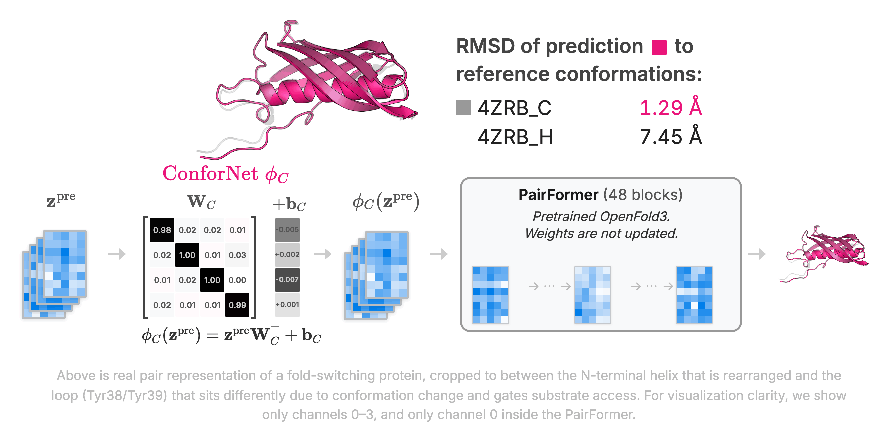

# ConforNets

Latents-based conformational control in OpenFold3.

<p align="center">
  <a href="https://arxiv.org/abs/2604.18559">
    
  </a>
  <a href="https://x.com/m1nj12/status/2046615914179916059">
    
  </a>
</p>
<p align="center">
  
</p>

## Setup

### Environment

Confornet depends on OpenFold3-preview (>= 0.4.0, a.k.a. OF3p2).

```bash
conda create -n confornet python=3.12
conda activate confornet

# 1. Install confornet (pulls OpenFold3 >= 0.4.0 and other deps)
pip install -e .

# 2. Reinstall OpenFold3 from GitHub main.
#    The current PyPI release may error on ColabFold MSA server queries
#    when a hit points to an obsolete PDB entry (e.g. 6rm0).
#    The fix is already on `main` but has not yet been released.
pip install --no-deps --force-reinstall \
    "openfold3 @ git+https://github.com/aqlaboratory/openfold-3.git@main"

# 3. Download OF3p2 checkpoint (~2.3 GB)
#    setup_openfold uses $OPENFOLD_CACHE as the destination; set it first if you
#    want the checkpoint somewhere other than the default (~/.cache/openfold).
export OPENFOLD_CACHE=/path/to/checkpoint/dir
setup_openfold
```

Evaluation uses the USalign binary at `packages/USalign`. See [packages/README.md](packages/README.md).

> [!IMPORTANT]
> The paper reports results with **OF3p1** (`of3_ft3_v1.pt`, OpenFold3 0.3.x). This checkpoint is **not compatible** with `openfold3 >= 0.4.0` and will fail to load. We are standardizing on **OF3p2** (`of3-p2-155k.pt`) going forward and will re-run the benchmarks; updated results will be posted.
> To reproduce the exact paper numbers, use **OF3p1** with `openfold3==0.3.1`.


## Demo 

A tiny benchmark under `repo/toy_assets/toy_benchmark/` (`mdfA` from `membrane` + `fs-4zrb_C-4zrb_H` from `foldswitching`) along with a pretrained `ConforNet` trained to fold membrane transporters toward the outward-facing conformation. Peak GPU memory usage < 24GB. 

```bash
BENCH=toy_benchmark
ASSETS=repo/toy_assets
CKPT=/path/to/of3-p2-155k.pt

# 1. Preprocessing — writes MSA + OF3p batches under $ASSETS/$BENCH/{msa,batch}.
python preprocess.py --benchmark $BENCH --assets-dir $ASSETS

# 2. k-ConforNet diversity training on both test cases.
python scripts/run_diversity.py \
    --benchmark $BENCH --assets-dir $ASSETS \
    --checkpoint $CKPT \
    --output-dir ./output/demo/diversity \
    --k-confornets 2 --num-runs 2 --num-samples 5
#   This will generate 2 * 2 * 4 * 5 = 80 samples per test case
#   May take ~30 GPU minutes. If you have multiple GPUs, launch with torchrun --nproc_per_node=4 

# 3. Conformation transfer — use the provided ConforNet
#    to fold the mdfA sequence. Demonstrates transfer.
python scripts/run_transfer.py \
    --benchmark $BENCH --assets-dir $ASSETS \
    --confornet-path $ASSETS/$BENCH/confornet/TM_0287v2_6QV1_B.pt \
    --test-case mdfA \
    --checkpoint $CKPT \
    --output-dir ./output/demo/transfer \
    --num-samples 10
#  10 samples generation, quick
```

See [`repo/demo.ipynb`](repo/demo.ipynb) for evaluation + py3Dmol overlay visualization of the outputs (`pip install py3Dmol`).

## Benchmarking

All benchmarks reported in the paper are provided under `assets/`. Follow the benchmark scaffolding in `assets/` (references, residue ranges, and test-case mappings); see [assets/README.md](assets/README.md) for details. Once you have defined your benchmark, or if you want to reproduce the paper results, see [scripts/README.md](scripts/README.md) for the benchmark entry points: `run_diversity`, `run_mse_training`, `run_transfer`, `run_baseline`, `evaluate`, and `summarize`.

> [!WARNING]
> ConforNets backpropagate through the Pairformer and therefore require more GPU memory than standard inference. Roughly speaking, a 40GB GPU can fit a ~300aa, while an 80GB GPU can fit ~600 aa. The `dist_cdf_mse` objective is currently less memory-efficient. We are actively working on memory optimizations.

### Preprocessing

`assets/` contains benchmark definitions and reference PDBs. Preprocessing computes MSAs and saves OF3p batches as `.pt` files.

```bash
# Default ./assets directory
python preprocess.py --benchmark domainmotion

# Custom assets directory (copies ./assets there first if needed)
python preprocess.py --benchmark domainmotion --assets-dir /scratch/assets

# Skip MSA step (not recommended unless you know what you're doing)
python preprocess.py --benchmark domainmotion --skip-msa
```

OF3p batches may take 10+ GB per benchmark.

### Parallelism

Two independent axes, both embarrassingly parallel (no cross-rank communication):

- **Intra-node, multi-GPU** — `torchrun --nproc_per_node=N`. Each script partitions its work by `job_idx % WORLD_SIZE == LOCAL_RANK`. Reads `LOCAL_RANK` / `WORLD_SIZE` (torchrun) or `FLUX_TASK_RANK` / `NRANKS_PER_NODE` (Flux); see `confornet/utils/dist.py`.
- **Inter-node, test-case sharding** — benchmark scripts accept `--num-nodes N --node-idx i`. Each invocation keeps only the test cases where `tc_idx % num_nodes == node_idx`. Launch one `torchrun` per node (SLURM array, multiple `srun`s, etc.).

Combine: `torchrun --nproc_per_node=4 -m scripts.run_diversity ... --num-nodes 8 --node-idx $NODE_IDX` = 4 GPUs × 8 nodes, disjoint.

## Changelog

- **OF3p2 switch**: default checkpoint is `of3-p2-155k.pt`; the paper's OF3p1 checkpoint will not load against `openfold3 >= 0.4.0`.
- **USAlign**: dropped the `mdtraj` / `bioemu_benchmarks` dependencies in favor of the USAlign binary. Introduces a 0.1–3 Å difference in global RMSD (~1–2% in reported success rates). Some OOD60 local test cases can show larger differences because the alignment method itself has changed.
